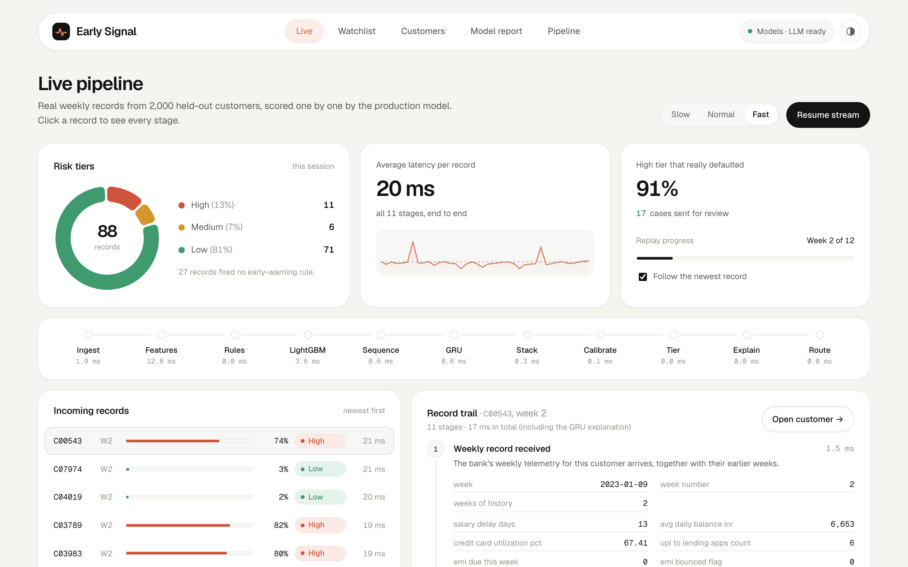
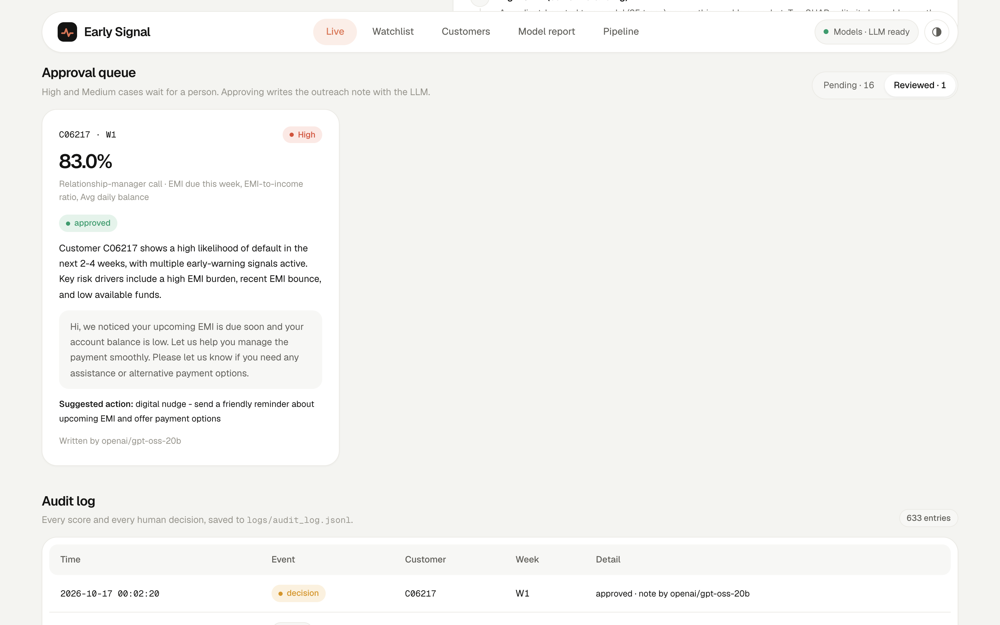
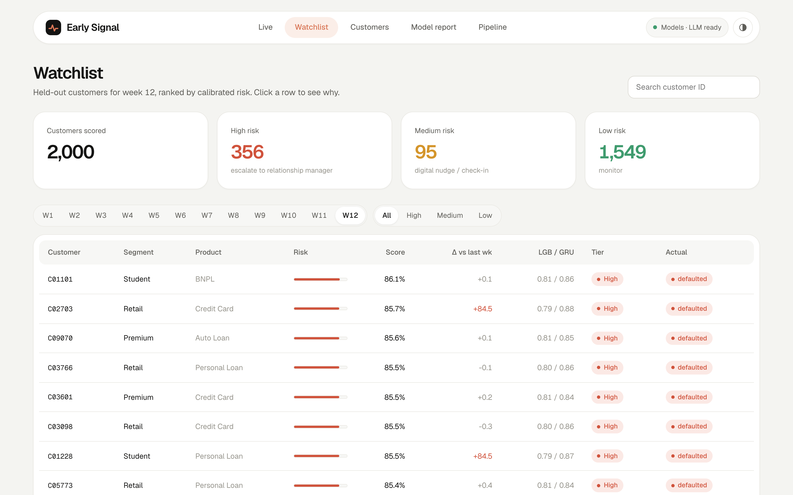
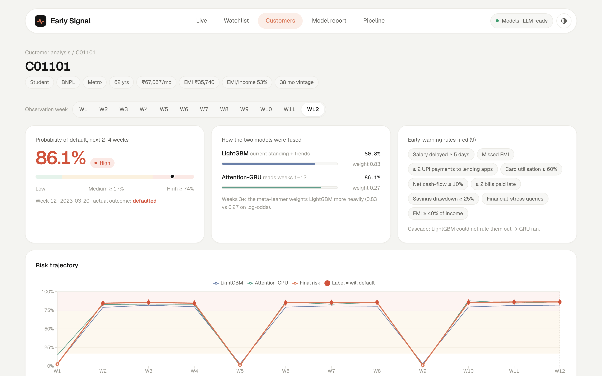
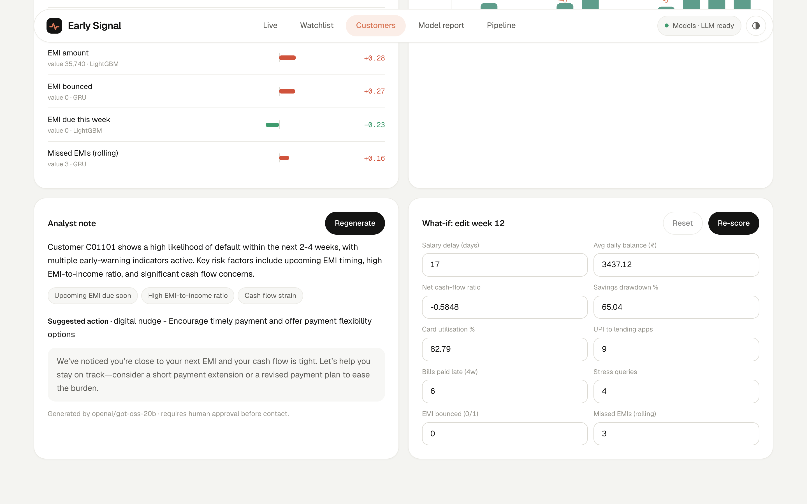
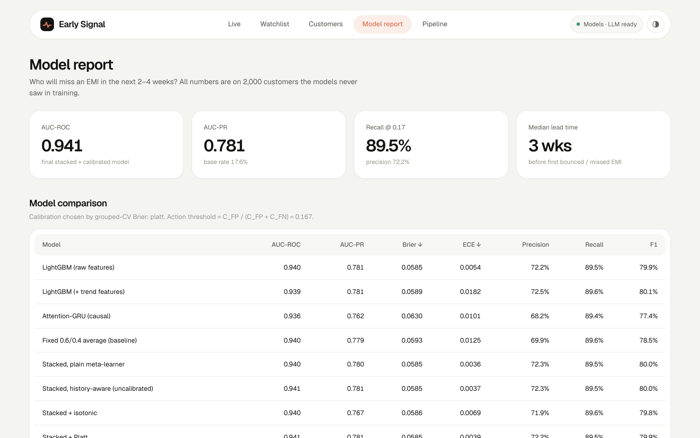
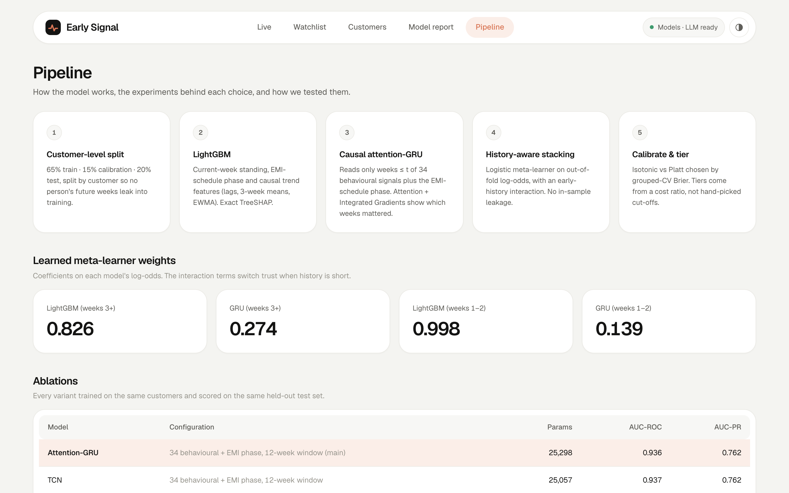
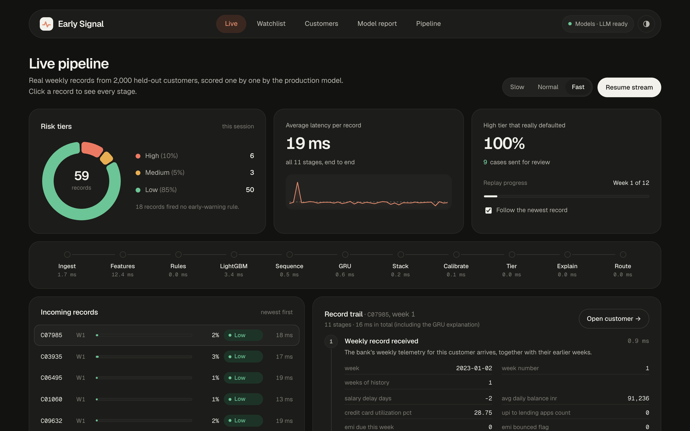

# Early Signal — Loan Pre-Delinquency Early Warning

**Group TY_11-22 · PICT** · Aarush Oak · Prathamesh Kinagi · Chaitanya Ranade

The system predicts which retail-loan customers will **bounce an EMI in the next 2–4 weeks**, using weekly
behavioural telemetry. It outputs a calibrated probability, a Low / Medium / High tier and an explanation
for every score.

```
weekly panel ─┬─> LightGBM (current standing + EMI phase + causal trends) ──┐
              │                                                             ├─> history-aware      ─> Platt / isotonic ─> cost-based tiers
              └─> causal attention-GRU (weeks 1..t only) ───────────────────┘   logistic stacker       (chosen by CV)        + TreeSHAP / IG
                                                                                (out-of-fold)                                + Groq narrative
```

## Screenshots

**Live pipeline.** Held-out test records are scored one by one. The page shows the tier mix, the latency and the time spent in each of the 11 stages.



**Approval queue and audit log.** A person approves each High or Medium case. Approval makes the Groq LLM write the outreach note.



**Watchlist.** All 2,000 test customers for one week, ranked by calibrated risk.



**Customer analysis.** The risk for each week, the fusion of the two models and the rules that fired.



**Analyst note and what-if.** The LLM explains the score. You can edit a week's values and score it again.



**Model report and pipeline.**





**Dark mode.**



## Live pipeline (the landing page)

Open the app and press **Start live stream**. Real weekly records from the 2,000 held-out customers are replayed and
scored one by one by the same `Scorer.score()` the API uses. Each record leaves a **trail** of 11 timed stages with the
real values each one produced:

`ingest → feature engineering → early-warning rules → LightGBM (+TreeSHAP) → sequence window → attention-GRU →
meta-learner (shown as the actual arithmetic) → calibration → risk tier → explanation → routing`

High and Medium cases enter an **approval queue**; approving one writes the outreach note (Groq LLM, or a template
without a key). Every scored record and every human decision is appended to `logs/audit_log.jsonl`.

## Results (2,000 held-out customers, 24,000 customer-weeks)

| Model | AUC-ROC | AUC-PR | Brier ↓ | ECE ↓ |
|---|---|---|---|---|
| LightGBM (raw features) | 0.940 | 0.781 | 0.0585 | 0.0054 |
| Attention-GRU (causal) | 0.936 | 0.762 | 0.0630 | 0.0101 |
| Fixed 0.6 / 0.4 average (baseline) | 0.940 | 0.779 | 0.0593 | 0.0125 |
| **Final: history-aware stack + Platt** | **0.941** | **0.781** | **0.0585** | **0.0039** |

- **Recall 89.5%, precision 72.2%** at the cost-optimal action threshold (0.167).
- **Tiers:** High tier customers default 79.7% of the time, Medium 56.3%, Low 2.5%.
- **Lead time:** among customers who later bounced or missed an EMI, 78% were flagged earlier, with a median of 3 weeks before the reactive flag.

Plots are in `reports/figures/`. Every number is in `reports/metrics.json`.

## Design choices

| Choice | Why |
|---|---|
| `scripts/train.py` trains and evaluates everything from the raw CSV | Every result can be reproduced |
| Causal windows: the row for week *t* sees only weeks ≤ *t* | The model must never read future weeks |
| Logistic meta-learner on **out-of-fold** log-odds, with an early-history interaction, then calibration | Learned, leak-free fusion. It beats a fixed `0.6·lgb + 0.4·gru` baseline on calibration |
| Medium = C_FP/(C_FP+C_FN) with a missed default costing 5× a false alarm; High = precision ≥ 80% on the calibration split | Thresholds come from a stated cost, not from hand-picked cut-offs |
| Integrated Gradients + attention per week for the GRU, TreeSHAP for LightGBM, merged in final log-odds space | Explanations that add up to the score |
| The rule pre-filter is audited, not trusted: it **drops 164 of 4,356 real defaulters (3.8%)** to save 27% of scoring | A LightGBM-screen cascade is used instead: 28% fewer GRU calls, 39 screened out, and they still get a score |

### Findings worth presenting

1. **The label is "EMI bounces in weeks t+2 … t+4".** It matches the data on 100% of checkable rows. EMIs fall due every 4 weeks, so a customer whose EMI bounces next week (t+1) is labelled 0. That is 4,584 rows where the most urgent customers are invisible to the target. A 1–4 week horizon would fix this.
2. **The EMI schedule is the strongest single signal.** The lender knows each loan's due date from day one, so we add `weeks_to_emi_due` as a contract field. LightGBM goes from 0.899 to 0.940 AUC with it. Without it, the GRU looked much better (0.933 vs 0.899) only because it inferred the cycle from history.
3. **With the schedule given to both models, LightGBM and the GRU are close.** The stack mainly improves calibration (ECE 0.0125 → 0.0039 vs the fixed average) and robustness. It does not add much ranking power.

### Ablations (held-out test)

| Sequence model | AUC-ROC | AUC-PR |
|---|---|---|
| Attention-GRU, 34 behavioural + EMI phase, 12-week window (main, 25k params) | 0.936 | 0.762 |
| TCN (dilated causal CNN), same inputs | 0.937 | 0.762 |
| Attention-GRU without EMI phase | 0.933 | 0.754 |
| Attention-GRU, 4-week window | 0.935 | 0.762 |
| Attention-GRU, 8-week window | 0.936 | 0.761 |
| Attention-GRU, 8 velocity features only | 0.927 | 0.727 |

## Run it

Needs Python 3.10+ and Node 18+.

```bash
python3 -m venv .venv && source .venv/bin/activate
pip install -r requirements.txt

cp .env.example .env        # optional: add GROQ_API_KEY for LLM narratives

python scripts/train.py     # ~8 min on a laptop CPU; --fast for a 1-min smoke run
./run.sh                    # builds the UI once, then serves UI + API at http://localhost:8000
# macOS: or just double-click start-demo.command (sets up everything, then opens the browser)
```

Frontend dev mode (hot reload): run `uvicorn api.main:app --port 8000` in one terminal and `cd frontend && npm run dev` in another, then open http://localhost:5173.

### LLM narratives

`src/ews/llm.py` calls Groq's OpenAI-compatible endpoint with the model named in `GROQ_MODEL` (default `openai/gpt-oss-20b`; `llama-3.1-8b-instant` was retired in Aug 2026). The LLM only rewrites the model's own numbers and drivers into plain language. It never sees raw customer data beyond those. Without a key, or if the call fails, the app shows a template narrative instead, so a demo can't break.

## Layout

```
src/ews/
  config.py      column groups, hyper-parameters, cost ratio
  data.py        loading, EMI schedule field, customer-level splits
  features.py    causal trend features, category codec, sequence windows
  tabular.py     LightGBM fit + TreeSHAP
  sequence.py    AttnGRU, TCN, training loop
  stacking.py    history-aware meta-learner, calibrator selection
  prefilter.py   early-warning rules + audit
  explain.py     Integrated Gradients, readable feature names
  metrics.py     AUC/PR/Brier/ECE, reliability, curves
  inference.py   Scorer used by the API (what-if supported)
  llm.py         Groq narrative with template fallback
scripts/train.py full training + evaluation + figures
api/main.py      FastAPI: /api/stream (SSE live pipeline), /trace, /queue, /audit, /metrics, /portfolio, /customers/{id}, /score, /narrative
frontend/        React + Vite UI (Live pipeline, Model report, Watchlist, Customer analysis, Pipeline & ablations)
```

## Data

`data/pre_delinquency_dataset.csv` is a synthetic weekly panel: 10,000 customers × 12 weeks, 46 columns. Its features are modelled on RBI / NHB early-warning-signal guidance and the Kaggle "Give Me Some Credit" dataset.
